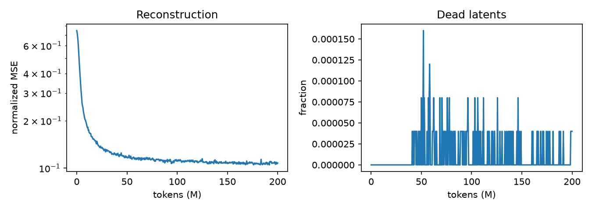
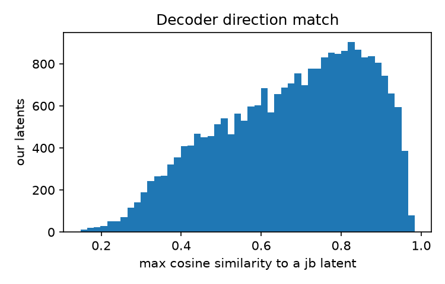

# gpt2-sae

A sparse autoencoder (SAE) trained from scratch on GPT-2 small, plus a browser for the features it learned.

**[Browse the features](PAGES_URL)** · 24,576 features · k = 32 · GPT-2 small, layer 6 residual stream · 200M training tokens

## Results

On 203k held-out OpenWebText tokens, compared against the public `gpt2-small-res-jb` SAE for the same layer:

| | This SAE | gpt2-small-res-jb |
|---|---:|---:|
| CE loss recovered | **0.991** | 0.982 |
| Fraction of variance unexplained | **0.113** | 0.134 |
| L0 (active features per token) | 32 | 51.9 |
| Dead features on eval text | 0.5% | 0.05% |
| CE loss: clean / with SAE / zeroed | 3.679 / 3.760 / 12.470 | 3.679 / 3.833 / 12.470 |

Splicing this SAE into GPT-2 raises next-token loss by 0.08 nats, which is about 1% of the gap to zero-ablating the layer. It uses fewer active features per token than jb's SAE and reconstructs better. That matches the claim in the TopK paper. The comparison is not exact: jb's SAE was trained with an L1 penalty, different hyperparameters and a different token budget.



Reconstruction stops improving much after about 60M tokens. Aux-k kept dead features near zero: at most 4 of 24,576 were dead at any point. 3 never fired on the 5M tokens used for feature stats.



For each of our features, this plot shows the cosine similarity between its decoder direction and the closest jb feature. The median is 0.70, and 10% are above 0.9. So the two SAEs share a core of common directions but split the space differently. Each feature in the browser links to its closest jb feature on Neuronpedia.

### Labels

200 live features were picked at random and labeled by `gpt-5.6-luna`. I checked 12 of them against their top contexts: 10 were correct and 2 were close but too broad or too narrow ([spot check](results/full/spot_check.md)). The model's self-reported confidence was not useful. Its median was 0.99.

Some labeled features:

| Feature | Label | Fires on |
|---|---|---|
| 2948 | "comes down to" phrase | " to" in "it all comes down to" |
| 9434 | "in response to" phrase | " response" after "in" |
| 11721 | Sentence-initial "Until" | "Until recently", "Until now" |
| 18621 | Expected event prediction | " expected" in "the trial is expected to last" |
| 3927 | Unicode replacement character | the first byte of a split multi-byte character |

### Steering

Adding a feature's decoder direction to the residual stream while GPT-2 generates. The coefficient is in units of the feature's largest natural activation. Same prompt and seed in each row.

**Feature 16163, "neural terminology"**, prompt "The new report says that":

| Coef | Continuation |
|---|---|
| 0 | more than 6 million people have been affected by climate change, with the number of people living in developing countries experiencing serious and irreversible health problems. |
| 1 | when a brain is infected with a new neurotoxin, it is the same cells that do the same response. They think the connection is related to the ability of the neurons to be activated. |
| 4 | tube tube tube tube tube tube to.g cells pathways project tube tube tube tube tube activity … |

**Feature 461, "galaxy mention"**, prompt "Yesterday I went to the":

| Coef | Continuation |
|---|---|
| 0 | Olympic Trials to complete the short to the Olympic Marathon. |
| 2 | Olympic gold-famed city to learn about the range of galaxies in the same cluster of dust-filled dust rich regions of Earth. |

At 1–2× the topic shifts and the text stays mostly fluent. At 4× every feature tried breaks the text. More samples are in the browser's Steering tab.

### Limitations

- One layer, one width, one k. There was no sweep.
- The browser shows 1,000 of the 24,576 features: all 200 labeled ones plus 800 random live ones.
- Labels come from one LLM pass over 10 snippets per feature, and only 12 were checked by hand.
- The jb comparison runs on the same tokens and code path, but the two SAEs were trained differently. It is a sanity check, not a controlled experiment.

## What an SAE does here

GPT-2 small passes a 768-dimensional vector (the residual stream) from layer to layer. Single dimensions of that vector rarely mean one thing. An SAE learns a larger set of directions, 24,576 here, and rewrites each vector as a sum of a few of them. Each direction is a "feature". Many features turn out to fire on one recognizable thing, such as a token, a topic or a piece of syntax.

This repo trains a TopK SAE ([Gao et al., 2024](https://arxiv.org/abs/2406.04093)) on the residual stream entering layer 6 (`blocks.6.hook_resid_pre`). TopK keeps the k = 32 largest latent activations for each token and sets the rest to zero. That fixes the sparsity directly, so there is no L1 penalty to tune.

## Method

- **Data.** OpenWebText, streamed from Hugging Face. Documents are packed into 128-token rows that start with a BOS token. The BOS position is dropped, because its norm is much larger than any other position's. Every 100th document is held out for evaluation.
- **Activations.** They are computed on the fly with TransformerLens and served from a shuffled buffer, so nothing is cached to disk.
- **SAE.** It has a pre-encoder bias, starts with the encoder tied to the decoder, and keeps decoder rows at unit norm. Inputs are scaled so their mean norm is √768. An auxiliary loss (aux-k) gives a gradient to latents that have not fired in the last 10M tokens.
- **Training.** Adam with lr 2e-4, batch size 4096 tokens, linear warmup, and linear decay over the last 20% of steps. The full run was on one A40 GPU on RunPod. Development ran locally on an M1.
- **Evaluation.** The SAE is measured on held-out text. The main number is *CE loss recovered*: splice the SAE's reconstruction into GPT-2 in place of the real activation, and measure how much of the gap between the clean loss and the zero-ablated loss it closes.
- **Comparison.** The same evaluation runs on the public `gpt2-small-res-jb` SAE for the same hook, loaded with [SAELens](https://github.com/jbloomAus/SAELens). Features are matched by the cosine similarity of their decoder directions.
- **Labels.** A random sample of live features gets labels from an OpenAI model (`gpt-5.6-luna`), which reads each feature's top-activating snippets and the output tokens it promotes. Some labels were checked by hand.
- **Steering.** Adding a feature's decoder direction to the residual stream during generation shows what the feature does, as well as what it detects.

## Repo layout

```
src/gpt2_sae/
  sae.py           TopK SAE
  activations.py   streaming data -> GPT-2 -> shuffled activation batches
  train.py         training loop, checkpoints, metrics.jsonl
  evaluate.py      FVU, L0, dead latents, CE loss recovered
  compare.py       gpt2-small-res-jb adapter and decoder matching
  features.py      top contexts, histograms, logit lens per latent
  autointerp.py    LLM labels (OpenAI)
  steer.py         generation with a feature added
  export.py        JSON for the browser
site/              static feature browser (GitHub Pages)
configs/           run configs
scripts/           RunPod helpers
results/           metrics and plots committed for this README
```

## Reproduce

```bash
uv sync --extra compare --extra label
uv run pytest
uv run gpt2-sae train --config configs/smoke.yaml      # small local check
```

The full run needs a CUDA GPU:

```bash
scripts/pod_sync.sh <ssh-host>                          # copy the repo to a RunPod pod and install
# on the pod, inside tmux:
bash scripts/pod_run.sh configs/full.yaml               # train, evaluate + compare, collect features
# back on the laptop:
scripts/pod_fetch.sh <ssh-host>
uv run gpt2-sae label  --config configs/full.yaml       # needs OPENAI_API_KEY
uv run gpt2-sae steer  --config configs/full.yaml --features <ids>
uv run gpt2-sae export --config configs/full.yaml
python -m http.server -d site                           # view the browser locally
```

## License

MIT
